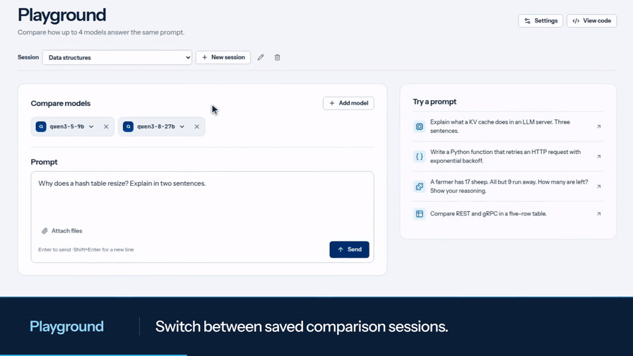

# Model Eval for Akamai Inference

Compare Akamai Inference models on the same prompt, grade their tool calls, and test the websites they generate.



## Run locally

You'll need Python 3.12+, Node.js 22.13+ with npm, Make, and an Akamai Inference API key. To create a key in Cloud Manager, open **AI → Inference → Serverless** and choose **Generate** under **Create API Key**. [Akamai Inference dashboard guide](https://techdocs.akamai.com/akamai-inference-beta/docs/use-the-akamai-inference-dashboard)

```sh
git clone https://github.com/akamai-developers/demo--model-eval.git
cd demo--model-eval
make setup
```

Set `AKAMAI_API_KEY` in the `.env` file created by setup. If you already export `AKAMAI_INFERENCE_API_KEY` for Akamai's quickstart, the server can use it directly. Run `make start`, then open [Model Eval on localhost](http://127.0.0.1:8080). The app binds to loopback and keeps the key on the server.

**Running on a remote machine?** Start the app there. On your Mac or Linux laptop, run the following with your usual SSH destination in place of `user@host`. Leave that terminal open and visit [the forwarded app](http://127.0.0.1:18080).

```sh
ssh -N -o ExitOnForwardFailure=yes -L 127.0.0.1:18080:127.0.0.1:8080 user@host
```

Use a trusted host. Anyone with access to the listening port can read saved results and send requests using the configured key.

## Using the app

| Screen | What you can do |
| --- | --- |
| **Models** | Filter by chat completions or embeddings. **Model docs** opens the publisher’s reference. |
| **Playground** | Type a question and press **Send** to compare up to four replies. **View code** shows the request in Python, curl or Node.js. |
| **Evals** | Choose a saved run and click a task score to see the input, expected answer and model reply. Reading saved results uses no inference tokens. **Run setup** starts a new evaluation. |
| **Websites** | Give models a shared brief. Open their pages at desktop, tablet or phone width, try the acceptance checks and record what worked. |
| **Docs** | Find Akamai’s API, model and usage guides, and the tool references used in evals. |

The catalog chooses the API operation from the model ID. To check image input, reasoning settings or function calling for a hosted model, open its details in Cloud Manager’s Model Library. [Akamai Model Library guide](https://techdocs.akamai.com/akamai-inference-beta/docs/choose-a-model-from-the-model-library#view-model-details)

### Playground sessions and attachments

Use **Session** to resume a conversation or **New session** to start another. The browser saves drafts, attachments, replies and model settings on this device. Reopen the same address and port to resume. Each model receives its own history.

Choose **Attach files** to add up to four files (8 MiB combined) per message. UTF-8 text and code files can contain up to 128 KiB. PDFs with selectable text and PNG, JPEG or WebP images can each be up to 4 MiB. PDF extraction runs in the browser and supports up to 40 pages and 128 KiB of extracted text. Choose an image-capable model for pictures or scanned pages. Sending a message shares its attachments with each selected model.

Choosing an example fills the draft so you can edit it before sending. Each request, including conversation history, can be up to 64 MiB. If a long conversation reaches that limit, start a new session.

### Compare saved evals

Choose a run under **Saved runs**, click **Compare runs**, then choose a **Baseline run**. Each run shows its requested reasoning setting, including **Model default**. New evals allow up to 1,024 output tokens per reply with reasoning off and 4,096 with reasoning on or set to the model default.

Switch **Metric** between pass count, output tokens, median time per example or, for tool tasks, correct tool choice. The table pairs completed answers with the same model, task, grader revision, input and expected answer. Unmatched results are counted separately. The address bar links directly to the selected run, comparison or answer drawer.

### Test tool selection

In **Run setup → Tasks → Tool use**, select **Claude Code-style tools**, **Pi coding tools** or **Akamai Cloud operations**. Choose **All** examples to include the longer cases. These suites send native function schemas to the selected models. A case can ask the model to clarify, choose between similarly named resources, or use an ID or file path learned from a previous tool response. Tool results come from fixtures. Each case takes up to three assistant turns.

Click a task score and expand **Tool trace** to inspect the function name, raw arguments and simulated response at each step. The leaderboard shows full passes and correct tool choices separately. For the text-based **Tool selection and arguments** task, returning `{"tool":"no_action","reason":"unsupported"}` earns credit for the choice and values. A full pass also requires `reason` inside the `arguments` object.

The fixtures define the tested subset of each tool set. [Claude Code tools](https://code.claude.com/docs/en/tools-reference) · [Pi coding tools](https://github.com/earendil-works/pi/blob/main/packages/coding-agent/src/core/tools/index.ts) · [Akamai Cloud API operations](https://techdocs.akamai.com/linode-api/reference/api-summary)

### Review a generated website

**Generated** means the output has HTML document boundaries. To check behavior, try a task in the sandboxed preview. For the spreadsheet, enter 2 and 4 in A1 and A2, then enter `=SUM(A1:A2)` in B1. It should show 6 and update to 9 when A1 changes to 5.

Each website reports completion tokens and, when the endpoint provides them, reasoning tokens. The completion total already includes reasoning. The live character counter shows progress while a reply streams. A `≥` count means only part of the build's reasoning usage was reported. Older builds may have no recorded count.

If the task fails, choose **Repair this page**, describe what happened, select **Repair reasoning**, and start the repair. The same model edits a copy. To compare reasoning on and off, submit the same feedback twice from the same original page. Both attempts appear in **Earlier builds**.

## Development

| Command | Purpose |
| --- | --- |
| `make dev` | Start FastAPI with reload and the Vite dev server on port 5173. |
| `make test` | Run the offline Python and frontend tests, then type-check the frontend. |
| `make build` | Type-check and build the frontend into `web/dist/`. |
| `make clean` | Remove the frontend build and test cache. |

The backend lives in `server/`, the React frontend in `web/src/`, and the starter tasks and website briefs in `server/fixtures/`. Evals and website builds run on the server while you switch screens. By default, `data/` holds saved runs, custom tasks, generated HTML and reviews. If you change `DATA_DIR`, choose a directory private to your account.

| Setting | Default | Purpose |
| --- | --- | --- |
| `AKAMAI_BASE_URL` | `https://api.akamai-inference.com/v1` | HTTPS inference endpoint. Local loopback endpoints also support HTTP. Supply credentials through the key setting. |
| `PORT` | `8080` | Backend port |
| `EVAL_CONCURRENCY` | `8` | Maximum simultaneous requests per eval run |
| `DATA_DIR` | `data/` | Directory for local results and custom tasks |

[Third-party asset notices](THIRD_PARTY_NOTICES.md)
